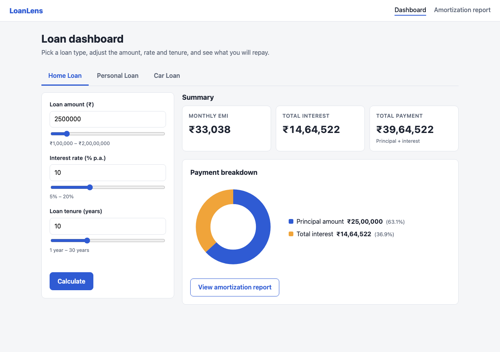
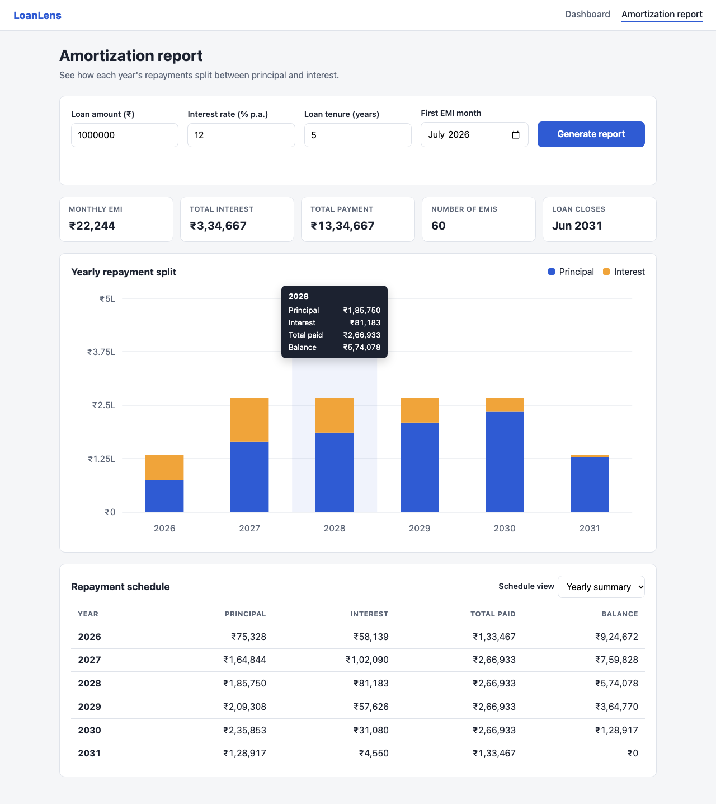
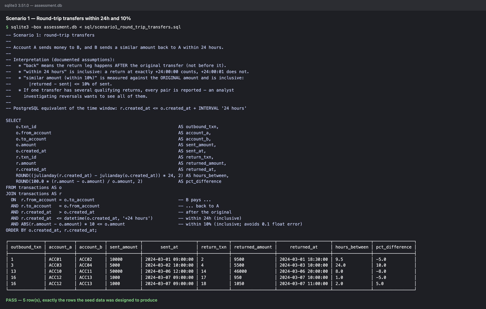
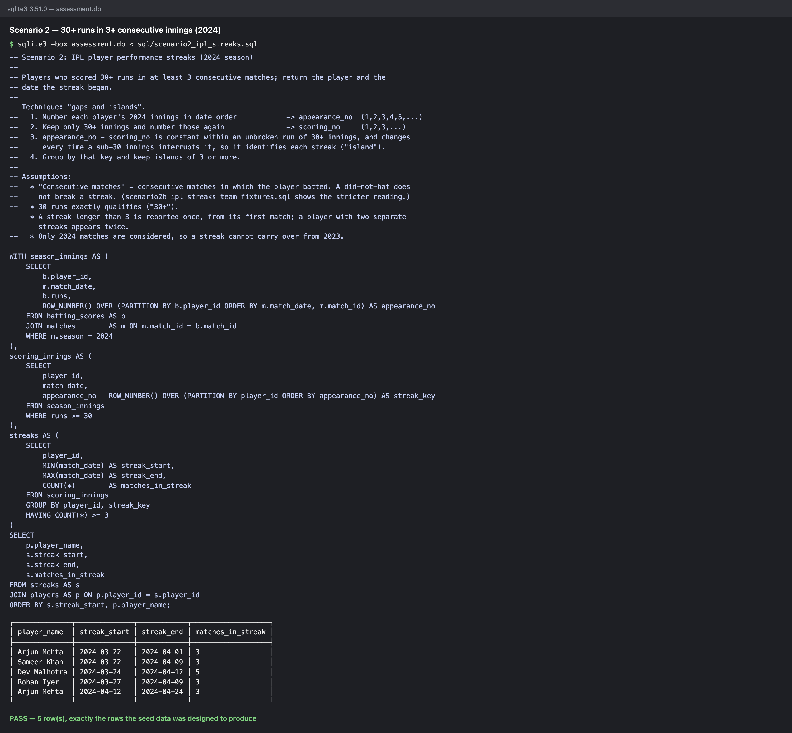

# Streamhub QA Automation Assessment — Section A

[](https://github.com/ankitsingh711/QA-Automation-Assessment/actions/workflows/tests.yml)

A small loan-calculator web app (**LoanLens**) and a Playwright + Cucumber framework that tests it. The repo also covers API boundary tests against JSONPlaceholder, the two SQL scenarios, and an AI self-healing locator exercise with a working proof of concept.

| Part | What's here | Where |
|---|---|---|
| **A1** Web app | Dashboard (summary cards, loan-type tabs, pie chart) and an amortization report (form, year filter, bar chart with tooltips, schedule table) | [`app/`](app/) |
| **A2** UI automation | 18 UI scenarios: Cucumber features, step definitions and page objects, with expected values computed independently | [`features/ui/`](features/ui/), [`src/`](src/) |
| **A3** API tests | 25 scenarios for `POST /posts` (16 regression + 9 known-issue), which found 3 defects | [`features/api/`](features/api/) |
| **A4** SQL | Schema, seed data, queries and screenshots, with each result self-checked | [`sql/`](sql/) |
| Self-healing | 5 intentionally broken locators, a design doc, and a POC (detect → suggest → validate → patch) | [`docs/SELF_HEALING.md`](docs/SELF_HEALING.md), [`self-healing/`](self-healing/) |
| **Results** | HTML/JSON/JUnit reports, screenshots, console logs and a summary | [`reports/SUMMARY.md`](reports/SUMMARY.md) |

**Why Section A:** we build and control the app under test, so the UI suite is deterministic. Section B's UI tests would target emicalculator.net, a third-party site with ads that can change under the tests.

---

## Results at a glance

| Suite | Expected | Result |
|---|---|---|
| Regression: UI + API (`npm test`) | all pass | **34 / 34 passed** |
| API known issues (`npm run test:known-issues`) | fail, by design | 9 / 9 fail → defects DEF-001 to DEF-003 |
| Self-healing, broken locators (`npm run test:self-healing`) | fail, by design | 5 / 5 fail (left broken, as required) |
| Self-healing POC (`npm run heal`) | heal all | 5 / 5 healed; patch verified (5 / 5 pass when applied) |
| SQL (`npm run sql`) | match designed results | 3 / 3 queries match |

**View the HTML reports in your browser** (served by GitHub Pages from the committed files):

- [Regression report — UI + API, 34 / 34 passed](https://ankitsingh711.github.io/QA-Automation-Assessment/reports/regression/cucumber-report.html)
- [API known-issues report — defects DEF-001 to DEF-003](https://ankitsingh711.github.io/QA-Automation-Assessment/reports/known-issues/cucumber-report.html)
- [Self-healing report — 5 intentionally broken locators](https://ankitsingh711.github.io/QA-Automation-Assessment/reports/self-healing/cucumber-report.html)

Each report embeds a screenshot per UI scenario and the expected-vs-displayed tables each step attaches. The full table with durations and console logs is in [`reports/SUMMARY.md`](reports/SUMMARY.md). Every push also reruns the regression suite in [GitHub Actions](https://github.com/ankitsingh711/QA-Automation-Assessment/actions/workflows/tests.yml).

| Dashboard + pie chart | Report + bar chart tooltip |
|---|---|
|  |  |

---

## Setup and running

**Prerequisites:** Node.js 22+ and npm. The `sqlite3` CLI (3.33+) is needed only for `npm run sql`; it is preinstalled on macOS and most Linux distributions.

```bash
npm ci
npx playwright install chromium

npm test                     # regression gate: UI + API (starts the app automatically)
npm run test:ui              # UI only
npm run test:api             # API resilience checks only
npm run test:known-issues    # API validation contract (fails: documents defects)
npm run test:self-healing    # intentionally broken locators (fails, by design)
npm run heal                 # self-healing POC (Claude if ANTHROPIC_API_KEY is set, else offline heuristic)
npm run sql                  # build SQLite DB, run + verify queries, save screenshots
npm run results              # run ALL of the above and regenerate reports/ + SUMMARY.md
npm start                    # just run the app → http://127.0.0.1:3000
npm run typecheck
```

Run a single feature or tag: `npx cucumber-js features/ui/dashboard.feature` or `npx cucumber-js --tags @chart`.

### Environment configuration

No URL or timeout is hard-coded. [`src/config/environment.ts`](src/config/environment.ts) loads `config/env/<TEST_ENV>.env` (default `local`). Real environment variables override the file.

```bash
TEST_ENV=ci npm test                          # config/env/ci.env
BASE_URL=http://my-host:8080 START_APP=false npm test
HEADLESS=false SLOW_MO_MS=250 npm run test:ui # watch it run
```

| Variable | Purpose |
|---|---|
| `BASE_URL`, `START_APP` | App under test; when `START_APP=true` the hooks start the app on that URL |
| `API_BASE_URL`, `API_MAX_RESPONSE_MS` | JSONPlaceholder base URL and response-time budget |
| `BROWSER`, `HEADLESS`, `SLOW_MO_MS`, `VIEWPORT_*` | Browser settings (`chromium`, `firefox` or `webkit`) |
| `STEP_TIMEOUT_MS`, `ACTION_TIMEOUT_MS` | Cucumber step and Playwright action timeouts |
| `SCREENSHOTS` (`always`/`failure`/`off`), `TRACE` (`on-failure`/`off`) | Evidence capture |

---

## Architecture

```
app/                          A1 — LoanLens (plain HTML/CSS/JS + tiny Node static server, no dependencies)
  server.js                   static server; exported startServer() is used by the test hooks
  public/js/loan-math.js      app's EMI/amortization maths (never imported by tests)
  public/js/charts.js         hand-rolled SVG donut + stacked bar chart, values exposed via ARIA/data-*
features/
  ui/                         dashboard.feature, amortization-report.feature
  api/                        create-post.feature
  self-healing/               legacy-locators.feature (@self-healing — broken on purpose)
src/
  config/environment.ts       env loading/validation
  support/world.ts            per-scenario World: page, API context, lazily created page objects
  support/hooks.ts            browser/app lifecycle, screenshots, traces, per-profile report dirs
  support/assertions.ts       web-first rupee assertions + evidence tables
  pages/                      Page Objects: BasePage, DashboardPage, ReportPage
  pages/components/           DonutChart, YearlyBarChart (reusable chart components)
  pages/legacy/               LegacyDashboardPage — the 5 brittle locators
  api/PostsApi.ts             API client (timing, raw bodies, safe JSON parsing)
  data/postPayloads.ts        named boundary/invalid payloads referenced from Gherkin
  steps/                      step definitions (thin: call page objects, assert)
  utils/loanCalculator.ts     independent test oracle for EMI + amortization
self-healing/                 POC: page snapshot, Claude + heuristic providers, validation gates
sql/                          schema, seed, scenario queries, runner, results/ (screenshots)
scripts/record-results.ts     runs everything and writes reports/SUMMARY.md
cucumber.js                   profiles: default, ui, api, knownIssues, selfHealing
```

**Design decisions**

- **An independent oracle.** Expected EMI, totals, yearly and monthly schedules and tooltip values all come from [`src/utils/loanCalculator.ts`](src/utils/loanCalculator.ts), written separately from the app's `loan-math.js`. If the tests imported the app's maths, a bug in it would pass. Where a feature file states a literal (for example "6 bars", "120 EMIs closing in Feb 2036"), the step also checks it against the oracle, so a typo in Gherkin can't pass silently.
- **Locator strategy.** Role and accessible name first (`getByRole('spinbutton', { name: 'Loan amount' })`, `getByRole('tab', { name: 'Home Loan' })`), then label, then `data-testid` for values that have no accessible role (summary figures, chart segments). Locators are **scoped** to their region (`getByRole('region', { name: 'Payment breakdown' })`), so a second "Total interest" elsewhere can't collide. There are no positional CSS or XPath selectors outside the deliberately broken legacy page.
- **Charts are testable by design.** The SVG charts render real DOM nodes with `data-value` attributes and ARIA labels, and the bars form an ARIA `list` of `listitem`s. Tests read the **values** (> 0, equal to the oracle) and also check the chart is actually **painted** (non-zero arc length and bar height), not merely present in the DOM.
- **Web-first assertions.** `expect(locator)` and `expect.poll` from `@playwright/test`, with no fixed sleeps anywhere.
- **Thin steps, smart page objects.** Steps read like the Gherkin, page objects own the locators, and components (`DonutChart`, `YearlyBarChart`) are reusable.
- **Evidence by default.** Each UI scenario attaches a full-page screenshot, oracle steps attach expected-vs-displayed tables, API steps attach the request and response summary, and a trace is saved on failure.
- **Lazy lifecycle.** The browser and app server start only when a `@ui` scenario runs, so API-only runs don't pay for a browser.

---

## A2 — UI coverage

| Requirement | Scenarios |
|---|---|
| Navigate to dashboard/report and validate it loads | *Dashboard loads with the default home loan figures*; *Report page loads with its parameter form* |
| Submit input, compare with independently computed value | EMI outline (4 loans across all 3 tabs, including 7.5% and 8.75% rates); slider update; *Generated report matches my own amortization schedule* (every yearly row ±₹1); monthly filter (12 rows for 2027); dashboard → report hand-off |
| Chart visible with non-zero, valid data | Pie: visible, both segments > 0 and painted, principal = loan amount, interest = oracle, legend = segments. Bar: visible, 6 bars counted, every bar > 0 and matches the oracle, hover tooltip for 2028 matches the oracle |
| Negative paths | Out-of-range amount, rate and tenure on both pages: error message shown, results cleared, chart replaced by an empty state |

The tests found two real bugs in the app while it was being built (see the reflection below).

---

## A3 — API tests: `POST /posts` (JSONPlaceholder)

Before writing assertions, I probed the endpoint with `curl` to see how it really behaves. **JSONPlaceholder is a mock: it accepts and echoes everything.** So the feature separates two concerns:

- **Regression (must pass):** no 5xx, valid JSON, response time within budget, and the data round-trips intact (a 100k-char title isn't truncated, and emoji/RTL/script tags come back byte-for-byte). This covers excessively long strings (10k, 100k and 1M chars), special characters (script tag, SQL injection, control characters, emoji plus RTL override), missing required fields (`userId`, `title`, empty object) and wrong types.
- **`@known-issue` (the contract the brief asks for):** invalid input should get a 4xx with an error message. These scenarios **fail** and are reported as defects, not deleted. They are excluded from the regression gate so the gate stays meaningful, and are run and reported separately.

### Defects found

| ID | Severity | Finding | Expected | Evidence |
|---|---|---|---|---|
| DEF-001 | Medium | No input validation: missing `userId`/`title`, an empty `{}`, `userId: "abc"`, a top-level array and control characters are all accepted with **201 Created** | 400 with a validation message | [known-issues report](reports/known-issues/console-output.txt) |
| DEF-002 | Low | No payload size limit: a 1,000,000-character title is accepted (201). A manual probe with 5 MB was also accepted | 413 / 400 | same |
| DEF-003 | **High** | Malformed JSON and invalid UTF-8 return **500 Internal Server Error**, and the body leaks a stack trace (`SyntaxError … at JSON.parse … /app/node_modules/body-parser/…`) | 400 with a generic message; no internals | same |

Observation, not a defect: script tags and SQL strings are stored and echoed verbatim. That is correct for a JSON API, since output encoding is the consumer's job, but any UI rendering these posts must escape them.

---

## A4 — SQL

SQLite 3.51 (window functions). Schema: [`sql/schema.sql`](sql/schema.sql) ([screenshot](sql/results/schema.png)). Seed data: [`sql/seed.sql`](sql/seed.sql), where every row is annotated with the rule it proves. `npm run sql` rebuilds the database, runs each query, **asserts the result equals the designed rows**, and saves text and PNG output to [`sql/results/`](sql/results/).

**Scenario 1: round-trip transfers** ([query](sql/scenario1_round_trip_transfers.sql)). A self-join of `transactions` on reversed accounts, where the return comes after the original, within 24 hours inclusive, and within 10% of the original amount inclusive. The 10% check is written as `ABS(diff) * 10 <= amount` so the boundary isn't subject to floating-point error. The seed covers exactly-24h, 24h+1s, exactly-10%, 11.25%, a duplicate payment in the same direction, A→B→C onward transfers, and one transfer with two qualifying returns.



**Scenario 2: 30+ runs in 3+ consecutive matches, 2024** ([query](sql/scenario2_ipl_streaks.sql)). Gaps-and-islands: `ROW_NUMBER()` over all of a player's innings, minus `ROW_NUMBER()` over their 30+ innings, is constant within a streak. The query returns player and streak start, plus end date and length. The seed covers exactly 30, 29 just missing, a 5-match streak (reported once), a player with two streaks, a 2023 → 2024 carry-over that must not count, and big scores that are never 3 in a row.



"Consecutive matches" is ambiguous, so I chose a reading and documented it. The main query counts consecutive *innings*, so a did-not-bat doesn't break a streak. [Scenario 2b](sql/scenario2b_ipl_streaks_team_fixtures.sql) shows the stricter *team fixtures* reading, where Sameer Khan drops out because he didn't bat in one match ([screenshot](sql/results/scenario2b_ipl_streaks_team_fixtures.png)). Players are fictional.

---

## AI self-healing exercise

The full write-up is in [`docs/SELF_HEALING.md`](docs/SELF_HEALING.md). In short:

- **Broken locators (5)** in [`LegacyDashboardPage.ts`](src/pages/legacy/LegacyDashboardPage.ts): an absolute XPath, a removed id, a positional CSS chain, a renamed `name` attribute, and outdated exact text. Each has an *intent* and a *fingerprint*.
- **Detection:** run the old selector and capture Playwright's error. Only locator failures are healed, never assertion failures.
- **Prompt:** send the intent, the error, the ARIA snapshot and a flat element list (not raw HTML). Claude returns structured `LocatorSpec` data via a Zod schema that *cannot express CSS or XPath*, so model output is never executed as code.
- **Validation gates:** no positional syntax → confidence threshold → exactly one match → visible → same kind as the last green run → same label as the last green run → performs the action. The output is a report plus a patch for human review. Nothing is auto-applied.
- **Result:** 5 / 5 healed. The generated patch, applied to a scratch copy, turns the 5 failing scenarios green.
- **Lesson:** the first version confidently healed *Total payment* to the *Total interest* card and passed every gate. That's why the last-known-label gate exists.

---

## Claude Code reflection

I'll be upfront: I leaned on Claude Code heavily for this one. I described what I wanted in plain English (a small app I control, Cucumber on top of Playwright, page objects, config in env files, expected values computed separately from the app) and it scaffolded most of it. My job was mostly steering, and checking whether what came back was actually right. Honestly, the checking turned out to be the more interesting part.

**What worked well**

The speed was real. Getting a working app, a test framework, the SQL, the self-healing POC and a single `npm run results` command that regenerates every report into one session would have taken me a lot longer by hand.

What helped most was making it check against something real instead of trusting what it "knew":

- Before writing any API assertions, we hit JSONPlaceholder with `curl` to see what it actually does. It accepts basically anything with a 201, and malformed JSON gives back a 500 with a stack trace. That changed how I structured the API tests: things that must hold (no 5xx, data comes back intact) went into the regression run, and the validation checks the brief asks for went into a separate `@known-issue` profile. Those fail on purpose and are written up as defects.
- For the Anthropic SDK and the tooling, it read the installed type definitions instead of going from memory. That mattered. For example, the newest TypeScript on npm (7.x) doesn't work with `ts-node`, so it had to be pinned to 5.9.
- The tests earned their keep on the first run. Seven scenarios failed, and they were two real bugs in the app, not in the tests. `svg.hidden = true` silently does nothing because `hidden` only exists on HTML elements, so the pie chart never hid on bad input. And a `display: grid` rule was overriding the `hidden` attribute, so an empty report section always showed.

It was also genuinely useful for things I don't write every day, like the gaps-and-islands trick for the IPL streak query and Playwright's `ariaSnapshot()`.

**Where it got things wrong**

This is the part I'd want anyone using these tools to take away. The mistakes that mattered weren't the ones that crashed. They were the ones that looked fine.

- **The self-healer "fixed" a locator onto the wrong element.** It mapped *Total payment* onto the *Total interest* card. It was unique, visible, showed a rupee amount, and passed every check the POC had at that point. The old test would even have gone green, because it only checked that the element showed a rupee amount. Nothing automated flagged it; it only showed up when the generated patch was actually read. That's why the healer now checks the card label the element sat under when the test last passed, and why it treats a tie between two candidates as "ask a human" rather than picking one.
- **Test data with a logic error.** One SQL seed case was labelled "the return happened before the original transfer". That can't exist, because whichever transfer comes first *is* the original. The query was right and the data was wrong, so the case was swapped for a duplicate payment in the same direction.
- **Small but real bugs:** a `0.10 * amount` float comparison sitting exactly on the inclusive 10% boundary (changed to integer maths), chart axis labels rounding ₹1.25L up to "₹1.3L", and Scenario Outline rows overwriting each other's screenshots.
- **An accessibility slip no test would catch.** The bar chart SVG first got `role="img"`, which hides the bars from screen readers. Playwright still found them, so every test passed. It was changed to `role="figure"`.

One thing I couldn't verify: the Claude-backed provider in the healer compiles against the SDK, but I didn't have an API key, so it never ran live. What's demonstrated is the offline fallback plus the validation gates.

**What I'd tell someone else**

AI was fastest wherever there was something solid to check it against: a test, the type checker, a real HTTP response, a screenshot. Where it was confidently wrong, the automated checks usually agreed with it, so someone had to read the output properly. That's also my view on self-healing locators in general. They're useful, but a healed locator should land as a reviewed pull request, never as an automatic commit.
